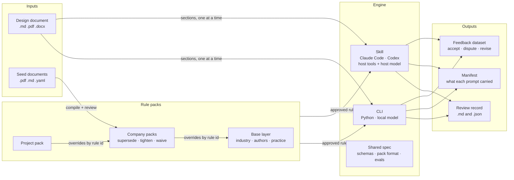
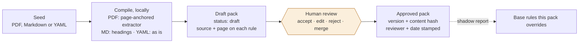
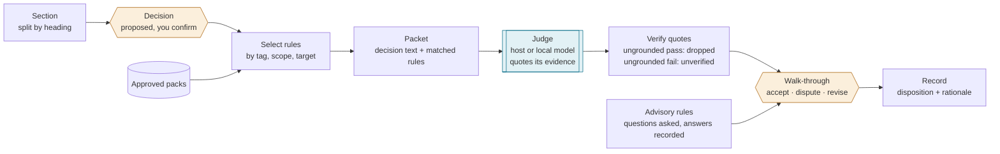

# Agent ARB

**An architecture review board you can run on your laptop.** Agent ARB reads a design document, finds the decisions in it, and reviews each one against your company's standards and against industry practice. It asks the author the questions a review board would ask, records their answers, and writes a review record. It advises and records. It never gates.

It runs two ways, with the same rules and the same output:

- as a **CLI** with a local open-source model, so nothing leaves your machine;
- as an **Agent Skill** inside Claude Code or Codex, using the host's own tools and model.

> Agent ARB reviews what a document says, not what production does. It is a design-time review, not an assessment or attestation against any compliance framework.

## Install

The CLI needs [`uv`](https://docs.astral.sh/uv/). Nothing else. If the machine has no Python 3.12, `uv` fetches one.

```bash
uv tool install agent-arb
```

Point it at a local model. The default is [Ollama](https://ollama.com) on its standard port:

```bash
ollama pull llama3.2:3b     # any model you prefer; larger models give better reviews
agent-arb init              # writes ~/.config/agent-arb/config.toml and checks the endpoint
```

Any OpenAI-compatible endpoint works by editing `[model]` in the config: vLLM, LM Studio, llama.cpp server.

**Model size matters.** Agent ARB only reports findings it can ground in the document, so a model that cannot quote the text accurately produces few verified findings. In testing, a 3B model quoted the rules instead of the document on almost every pass verdict and those were all discarded, leaving only unverified failures. Use a 7B class model or larger for real reviews, and run `uv run python evals/run_evals.py` to see how your model scores before trusting it.

The skill installs into Claude Code or Codex with the skills CLI, and needs only a Python 3 interpreter on the path. It does not need the CLI.

```bash
npx skills add pckeyan/agent-arb@agent-arb -g
```

Or copy `skills/agent-arb/` into `~/.claude/skills/` or `~/.codex/skills/`.

## Use

```bash
agent-arb review design.md                        # built-in packs, interactive
agent-arb review design.md --seeds ./standards    # plus your compiled company packs
agent-arb review design.md --tier 1 --challenge   # ask the author to justify before showing findings
agent-arb review design.md --no-interactive       # for CI; every finding is left open
```

Compile your own standards from a PDF, Markdown or YAML seed, then approve the draft rules one by one. Only approved rules ever run.

```bash
agent-arb rules compile standards.pdf --out acme.yaml
agent-arb rules approve acme.yaml --reviewer "your name"
agent-arb rules list --seeds acme.yaml            # shows which base rules your pack overrides
```

The record lands in `.agent-arb/` next to the document as Markdown and JSON, with a manifest listing exactly what every prompt contained.

Try it on the example:

```bash
agent-arb review examples/orders-service-design.md --seeds examples/seeds/acme-overrides.yaml --tier 1
```

## How it works

### The whole system



Both engines take the same two feeds and write the same three outputs. Seed documents never reach an engine directly; they become rules first.

### From seed document to approved rules



Markdown and YAML seeds compile with no model at all. A PDF goes through a local extractor. The gate is the same in the CLI and the skill.

### One decision through the review



The judge may also answer that a rule is not applicable to a decision, which is recorded as a count rather than a finding, so a storage choice is not failed for saying nothing about retries. A pass whose quote is not in the text is dropped before anyone sees it; a near-miss quote is snapped to the real sentence it paraphrases; a failure whose quote is not in the text, or that offers none, is kept but marked unverified, since a wrong citation does not make the concern wrong and an absence cannot be quoted. Two model calls per decision at most: proposing it and judging it. Two human gates: confirming the decision list and walking through findings. The packet is the only thing that leaves the process, and it holds one decision's text plus the rules selected for it. Challenge mode asks the advisory questions before the judge runs.

### Who does each step

| Step | CLI, Python with a local model | Skill, inside Claude Code or Codex |
|---|---|---|
| Ingest | Split by headings; PDF and Word converted locally | `Grep` for headings, `Read` by line range |
| Decisions | Local model, one section per prompt | Host model, one section per prompt |
| Confirm | Terminal prompt | Conversation with the host agent |
| Select rules | Tag family, scope, target match in Python | `scripts/select_rules.py`, standard library only |
| Judge | Local model, temperature 0 | Host model, one packet per prompt |
| Verify quotes | Verbatim check, ungrounded passes dropped | `scripts/verify_quotes.py` |
| Walk-through | Terminal prompt per finding | Conversation per finding |
| Record | Markdown and JSON to the spec | `Write` Markdown and JSON to the same spec |
| Compile seeds | Full pipeline, PDF included | Markdown and YAML; PDF seeds are compiled with the CLI once and the pack shared |

In skill mode the host's context accumulates over a session, so by the end most sections have been sent one at a time. The skill never reads a whole document or pack at once, never reads seed PDFs, and never touches material the current decision does not need. For documents that must not leave the machine, use the CLI with a local model.

## The packs

Every pack uses one rule format. `scope` decides which sections a rule can fire on, `target` whether it runs per decision or once per document, and `type` whether it is a pass-or-fail check or an advisory question the board asks.

| Layer | Pack | Sources |
|---|---|---|
| Base | Industry: reliability, resilience, recovery, scalability, observability and service levels, security, service-to-service auth, PCI DSS data handling, cost | NIST SP 800-34, 800-52, 800-53, 800-57, 800-204 series, 800-207 (public domain); Google Cloud Architecture Framework, Azure Well-Architected, Kubernetes docs, OpenTelemetry docs, FinOps Framework, C4 model (CC BY 4.0); Twelve-Factor (MIT) |
| Base | Authors: distributed foundations, integration and messaging, stability and operations, structure and domain, evolution and delivery, API and concurrency | Principles restated in our own words with a citation. See `rules/canon.yaml` |
| Base | Practice: how the decision-making itself shows up on the page | Nygard, Hohpe, Harmel-Law, Richards and Ford, Bass Clements and Kazman, Fairbanks, Keeling, Ousterhout, Schutta |
| Company | Your standards, compiled from your seeds and approved by you | Overrides base by rule id with `supersedes`, `tightens` or `waives` |
| Project | This system's rules | Same format, highest precedence |

Proprietary, non-commercial and share-alike sources such as AWS Well-Architected, the Google SRE books, ISO, TOGAF, PCI DSS and OWASP are linked as references on the relevant rules and never copied. The whole repository stays under one licence. Attributions are in [ATTRIBUTIONS.md](ATTRIBUTIONS.md).

Monitoring and alerting rules carry a maturity `level` from 1 to 4; the record reports the observed level against a target derived from the service tier in `rules/tiers.yaml`. Rules with `compliance_refs` feed a traceability table in the record.

## One rule

```yaml
id: PRC-DEC-004
title: Reversibility is stated
scope: practice
target: decision
type: advisory
severity: medium
tags: [reversibility, decision-record]
question: >
  Is this a one-way door or a two-way door? What would it cost to reverse it
  in a year, and what would it cost to defer it until more is known?
source:
  kind: author-principle
  name: Gregor Hohpe
  locator: The Software Architect Elevator, Chapter on selling options
  text_reused: none
status: approved
```

## Project status

Agent ARB is shared so others can use it and talk about the idea. **Pull requests are not accepted.** Bug reports and questions are welcome in Discussions. The repository is Apache-2.0; see [LICENSE](LICENSE), [NOTICE](NOTICE) and [SECURITY.md](SECURITY.md).

Backlog, kept out of the first release: Anthropic, OpenAI, Gemini and Grok APIs; Gemini CLI and Cursor hosts; an MCP server; evidence connectors that read monitoring-as-code and mesh policy files; a monthly coverage and discovery report.

## Development

```bash
uv sync
uv run pytest
uv run ruff check .
uv run python scripts/export_spec.py   # after changing models
uv run python scripts/sync_packs.py    # copies packs into the skill as JSON
```
